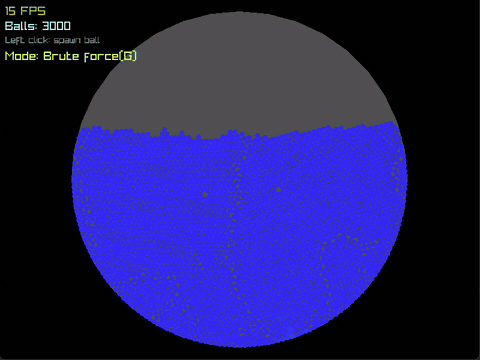

# Real-Time 2D Physics Sandbox

A real-time 2D physics simulation written from scratch in **C++17**, using **raylib** only for drawing.
Thousands of balls fall into a round bowl, bump into each other and settle into a pile, all at a smooth 60 FPS.

The main highlight: a **spatial grid** that makes collision detection fast. With 3,000 balls, the simple
approach drops to **16 FPS**, while the grid keeps the simulation at **60 FPS**.



*3,000 balls. Brute force runs at about 14 FPS. Pressing **G** switches to the spatial grid, which runs at about 52 FPS.
(Recorded with screen capture running, which lowers FPS a little.)*

---

## Results

We measured both collision methods in the same app, on the same laptop, with the same settings.
Press **G** while the app is running to switch between them.

| Balls | Brute force (check every pair) | Spatial grid (check only neighbours) |
|---:|---:|---:|
| 500 | 60 FPS | 60 FPS |
| 1,000 | 60 FPS | 60 FPS |
| 1,500 | 47 FPS | 60 FPS |
| 2,000 | 30 FPS | 60 FPS |
| 2,500 | 20 FPS | 60 FPS |
| 3,000 | **16 FPS** | **60 FPS** |

**What this shows**

- **Brute force** stays smooth up to about 1,000 balls. After that, FPS keeps dropping as balls are added.
- **The spatial grid** stayed at 60 FPS at every size we tested.
- 60 FPS is the frame cap of the app, so the grid's real limit is **higher than 3,000 balls**. We have not measured where it is yet.
- At 3,000 balls the grid gives **3.75× the frame rate** of brute force.

**Test setup**

- Laptop: AMD Ryzen 7 170 with Radeon graphics, 16 GB RAM, Windows 11
- Release build, window 800 × 600, ball radius 4 px, 8 physics sub-steps per frame
- FPS read from the on-screen counter after all balls had finished spawning
- Screen recording lowers FPS a little. In the demo clip, 3,000 balls run at about 14 FPS (brute force) and about 52 FPS (grid).

---

## How the physics works

Every frame, the engine runs these steps 8 times (8 small sub-steps are more stable than 1 big step):

1. **Gravity** pulls every ball down.
2. **The bowl wall**: a ball that moves outside the circle is put back on the edge.
3. **Collisions**: when two balls overlap, both are pushed apart by half of the overlap.
4. **Movement (Verlet integration)**: each ball remembers where it is now and where it was one step ago.
   The difference between the two is its speed, so the engine never stores speed separately.
   This makes walls and collisions simple and stable, because moving a ball automatically fixes its speed.

The physics always moves forward by the same small amount of time (1/60 s per frame).
If the computer is slow, the simulation runs in slow motion instead of breaking apart.

---

## The optimization: spatial grid

**The problem.** The simple way to find collisions is to check every ball against every other ball.
With 3,000 balls that is about **4.5 million pairs per sub-step**. Almost all of them are far apart and can never touch.
The work grows with the square of the number of balls (O(n²)): twice the balls means about four times the work.

**The idea.** Two balls can only touch if they are close to each other. So we split the screen into small
squares (cells) and only compare balls in nearby cells.

```text
┌───┬───┬───┬───┬───┐
│   │   │   │ ● │   │    ● = some ball
├───┼───┼───┼───┼───┤    # = the 9 cells this ball checks
│   │ # │ # │ # │   │
├───┼───┼───┼───┼───┤    Everything else on the screen is skipped.
│   │ # │ ● │ # │   │
├───┼───┼───┼───┼───┤
│   │ # │ # │ # │   │
└───┴───┴───┴───┴───┘
```

**How it works, step by step (every sub-step):**

1. **Build the grid once.** Each cell is 8 × 8 px, the same size as one ball.
   The 800 × 600 window becomes 100 × 75 = **7,500 cells**.
2. **Fill the grid.** Empty every cell, then put each ball's number into the cell it is in:
   `column = x ÷ 8`, `row = y ÷ 8`, `cell = row × 100 + column`.
3. **Check neighbours only.** For every cell that has balls, look at that cell and the 8 cells around it,
   and check each pair of balls once. The collision math is the same as before. Only the list of pairs changes.

**Why it is faster.** A cell is as big as one ball, so it holds only 1–2 balls. Each ball is compared with a
handful of nearby balls instead of all the others. The work now grows in a straight line with the number of
balls (about O(n)): twice the balls means about twice the work.

---

## Controls

| Key | Action |
|---|---|
| **G** | Switch between brute force and spatial grid (shown on screen as "Mode") |
| **Left mouse button** | Spawn balls at the cursor |
| **Esc** | Quit |

The on-screen panel shows FPS, the number of balls and the current mode. Ball colour shows speed: blue is slow, red is fast.

---

## Build and Run

**Requirements:** CMake 3.20+ and Visual Studio Build Tools (MSVC). raylib is downloaded automatically by CMake.

```bash
git clone https://github.com/divyanshusharma11/Real_Time_2D_Physics_SandBox.git
cd Real_Time_2D_Physics_SandBox
cmake -S . -B build
cmake --build build --config Release
.\build\Release\sandbox.exe
```

Use the **Release** build to see the real performance. The Debug build is several times slower.

---

## Project Structure

```text
Real_Time_2D_Physics_SandBox/
├── CMakeLists.txt     build setup, downloads raylib
├── readme.md
├── docs/
│   └── demo.gif       demo animation shown in this README
└── src/
    ├── main.cpp       main loop: spawns balls, runs physics, draws the frame
    ├── solver.hpp     physics engine: Verlet, gravity, bowl, collisions, spatial grid
    └── ui.hpp         speed-based colours and the on-screen panel (HUD)
```

---

## Tech Stack

| Technology | Purpose |
|---|---|
| C++17 | Physics engine and application |
| raylib 5.5 | Window, drawing and input |
| CMake | Build system and dependency download |
| Git & GitHub | Version control, pull requests and code reviews |

---

## Team

| Developer | Work |
|---|---|
| Ashwani | Physics engine (Verlet, gravity, bowl, collisions), spatial grid optimization, benchmarking |
| Divyanshu | UI and rendering, speed-based colours, HUD, mouse interaction, README |

We worked with feature branches and pull requests, and reviewed each other's pull requests.

---

## Roadmap

- [x] Project setup and particle simulation
- [x] Verlet integration and gravity
- [x] Collision detection and circular boundary
- [x] Rendering, colours, HUD and mouse input
- [x] Spatial grid optimization
- [x] Benchmark: brute force vs spatial grid

**Next ideas**

- Remove the 60 FPS cap during benchmarks to measure the grid's true speed-up and its real ball limit.
- Skip the square root in collision checks (compare squared distances first).
- Use several CPU cores for the grid (multi-threading).
